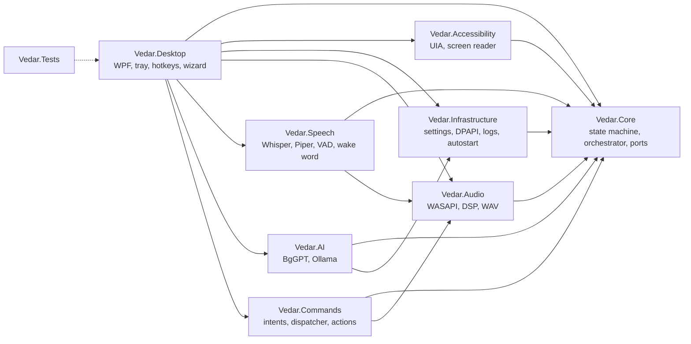

# Архитектура на VEDAR

## Общ поглед

VEDAR е настолно приложение за Windows (.NET 10, WPF), изградено по модела **„портове и адаптери“**:
`Vedar.Core` съдържа логиката и интерфейсите (портове), а останалите проекти съдържат реализациите
(адаптери). Така разпознаването на реч, гласът и изкуственият интелект могат да се сменят, без да се
пипа логиката.



| Проект | Платформа | Отговорност |
|---|---|---|
| **Vedar.Core** | net10.0 | Машина на състоянията, оркестратор, интерфейси, модел на настройките, български числа/дати, локализация, разговор, системен prompt |
| **Vedar.Infrastructure** | net10.0 | Пътища, JSON настройки (атомарен запис), DPAPI тайни, файлов дневник с маскиране на тайни, HKCU autostart, шифрована история, изтриване на данни, каталог и изтегляне на модели |
| **Vedar.Audio** | net10.0 (WASAPI само под Windows) | Микрофон и възпроизвеждане (NAudio/WASAPI), ресемплиране, high-pass филтър, WAV, системна сила на звука, тестови двойници |
| **Vedar.Speech** | net10.0 | Whisper.cpp (Whisper.net), Piper (sherpa-onnx), нормализация на български текст, VAD, слушател, wake word, филтри за халюцинации |
| **Vedar.AI** | net10.0 | OpenAI-съвместим клиент със стрийминг (BgGPT), Ollama, маршрутизатор с резервен доставчик |
| **Vedar.Commands** | net10.0 | Разпознаване на български команди, диспечер с позволен списък, безопасни Windows действия, четене на файлове |
| **Vedar.Accessibility** | net10.0-windows | Откриване на екранен четец, UIA известия, одитор на достъпността |
| **Vedar.Desktop** | net10.0-windows (WPF) | `VEDAR.exe`: прозорци, MVVM, системна област, глобални клавиши, първоначална настройка, composition root |
| **Vedar.Tests** | net10.0 + net10.0-windows | Автоматични тестове (виж DEVELOPER_GUIDE.md) |
| tools/Vedar.Tools | net10.0 | Подготовка на модела за build-а, бенчмаркове на речта |

## Поток на данните

```
Микрофон ──WASAPI──► 16 kHz моно ──► high-pass ──► VAD (енергия + адаптивен шум) ──► изказване
                                                                                        │
           ┌──────────────── режим „Ведар“ (без ръце) ────────────────┐                │
           ▼                                                            │                ▼
  Whisper base (първите 4 s, prompt „Ведар“) ──► WakeWordMatcher ──► Whisper small (prompt с команди)
                                                                                        │
                                                                                        ▼
                                                     CommandDispatcher (позволен списък, потвърждения)
                                                         │ разпозната            │ неразпозната
                                                         ▼                       ▼
                                                  локално действие       BgGPT / Ollama (стрийминг)
                                                         │                       │  по изречения
                                                         ▼                       ▼
                                   Нормализация на текста ──► Piper (sherpa-onnx) ──► WASAPI ──► Тонколони
```

## Оркестратор и „ходове“

`AssistantOrchestrator` организира работата в **ходове** (turns): изказване → разпознаване → команда или
AI → говорене. Ключови свойства:

* **Един ход в даден момент.** Нов глас по време на ход се пренебрегва. Затова **две AI заявки за един и
  същи разговор никога не се изпълняват едновременно** (тествано).
* **Спирането има приоритет.** `Stop()` отменя `CancellationToken` на текущия ход синхронно. Синтезът на
  Piper се прекъсва дори по средата на изречение (native callback), възпроизвеждането спира до ~50 ms,
  заявката към BgGPT се прекъсва.
* **Ведар не чува себе си.** През целия ход обикновените команди са „потиснати“ (`IVoiceListener.Suppressed`);
  след говоренето има опашка от 350 ms срещу ехото в стаята.
* **„Ведар, спри“ докато говори (barge-in).** Докато Ведар говори или чака AI, слушателят реже звука на
  парчета до 4 s (`BargeInCaptured`); бързият модел (base) ги разпознава една по една, а
  `StopPhraseDetector` решава: думите от изречението, което звучи в момента (и предишното), са ехо;
  „спри/стоп/стига“ се търсят по корен (бързият модел ги изкривява върху гласа на Ведар); „Ведар“ от
  потребителя + такава дума спира винаги; дълго парче без „Ведар“ не спира. „Ведар, <молба>“ прекъсва и
  изпълнява молбата. Проверката се отменя в края на хода, за да не забавя следващата команда. Няма
  ехо-компенсация: със слушалки работи добре, със силни тонколони — по-слабо (docs/SPEECH_BENCHMARKS.md, т. 6).
* **Гласова настройка.** `VoiceSetupDialog` (Core/Setup) е диалог с въпроси и отговори вътре в ходовете на
  оркестратора: след всеки въпрос Ведар слуша без думата „Ведар“, с подсказка за разпознаването според
  въпроса („Да. Не.“, „По-бързо. По-бавно. Добре.“). `ApiKeyPaste` взима ключ от клипборда, почиства го,
  записва го с DPAPI, изчиства клипборда и проверява връзката; ключът не се изговаря и не се показва.
* **Слушане след реплика (като човек).** В края на всеки ход `EndTurnAsync` решава как да слуша:
  изрично зададено (въпрос → `ExpectAnswer`, микрофонът изключен → Off), след „Ведар, спри“ — тихо
  слушане, иначе — ако ходът е казал нещо, **тихо слушане без „Ведар“** за `FollowUpSeconds` (120 s):
  без сигнал, без известие „Слушам“, шум или собственото ехо (`EchoDetector`) не затварят прозореца
  (`ContinueAttentiveListening` продължава остатъка от него), „Не те разбрах“ — само веднъж. Ако
  потребителят е натиснал клавиш след началото на прозореца (`IUserActivityMonitor`, GetLastInputInfo —
  само време, без клавиши), изказването минава през проверката за „Ведар“ (екранният четец може да говори).
  „Довиждане“, тестът на гласа, клавишът за спиране и грешките на микрофона не отварят това слушане.
* **Отговор след паузата, без прекъсване.** При 450 ms тишина `VoiceListener` подава звука досега
  (`SpeechPaused`); оркестраторът започва разпознаване (`Speculation`), което се използва, ако потребителят
  не продължи (спестява до ~1 s) — но Ведар никога не отговаря преди края на паузата (1,4 s, и след
  „Ведар“). Включва се само ако големият модел отговаря средно за ≤ 2,5 s: whisper.cpp проверява за отказ
  едва след енкодера, така че отменено разпознаване заема процесора (измерено: следващото 6,6 s вместо 3,8 s).
  Когато потребителят продължи след паузата, `LearnLongerPause` увеличава паузата с 0,15 s (до 2,4 s).
* **Потребителят говори, докато Ведар говори или мисли.** `EchoAwareSpeechDetector` (Speech/Vad) знае какво
  пуска Ведар (`NotePlayback` през `ListenerAwareOutput`) и по нивото на всеки 30 ms кадър, закъснението
  (корелация на нивата) и наученото усилване на ехото (медиана и 90-и перцентил) предсказва собствения му глас
  в микрофона; кадър е на потребителя, ако е ясно над предсказаното ехо и шума; 5 от 8 кадъра = потребителят
  говори. Слушалки се разпознават по липса на корелация. `VoiceListener` тогава записва гласа на
  потребителя от 600 ms преди засичането до паузата в края, независимо какво прави Ведар междувременно
  (`UserSpeechStarted`/`UserSpeechCaptured`). Оркестраторът намалява гласа (`IAudioOutput.Ducked`, −15 dB,
  с плавен преход) и след 0,7 s разпознава началото с бързия модел: стоп-дума → стоп; собствени думи (не ехо)
  или Ведар още не е започнал да отговаря → `Interruption`: ходът се прекратява и `EndTurnAsync` пуска хода
  „user-speech“, който изчаква края на речта (ако Ведар още мислеше — слепва я с предишното изказване) и
  я обработва като команда (без водещите думи на Ведар, `EchoDetector.StripLeadingEcho`); иначе гласът се
  връща. Barge-in остава включен и през опашката след говоренето, а при начало на слушането последните
  300 ms стават предварителен запис — няма „мъртва зона“.
* **Второ мнение срещу измислени думи.** Кратко изказване (до 3 думи) или точна примерна команда от
  подсказката минава през `AssistantOrchestrator.Judge`: бързият модел (без примерите) разпознава същия
  звук (`SpeechAgreement`: 2·общите букви / дължината на двата текста), а `VoicePresence` (Core/Audio) мери
  колко милисекунди от звука са глас — периодичност 70–400 Hz над фона, лентов филтър 70 Hz – 1 kHz, без
  модел. Сходство ≥ 0,8 → реч; без глас (< 80 ms) → шум, тишина; с глас и ≥ 0,5 → реч; с глас и < 0,5 →
  неясно: „Моля?“ веднъж, после тихо слушане.
* **Кратък разговор.** `SmallTalk` (Core/Conversation, общ за диспечера и оркестратора) отговаря на поздрави
  (по часа, с името, без второ „здравей“), „как си“ и отговора на него, благодарности и сбогуване. Тези
  реплики се пазят в контекста на разговора, така че AI разбира следващото „да“ или „зле съм“.
* **Без блокиране.** Всеки ход завършва в `finally`, който връща състоянието към Idle (или Listening).
  Неочаквани грешки водят до състояние Error, кратко гласово съобщение и връщане към Idle (тествано).
* **Стрийминг към гласа.** Отговорът на AI се реже на изречения (`StreamingSentenceChunker`) и
  `SpeechPlaybackQueue` синтезира следващото изречение, докато текущото звучи.

### Състояния

`Starting → Idle ⇄ Listening → Recognizing → Processing → Speaking → Idle`, плюс `Error` и `Stopped`.
От всяко състояние може да се отиде в Idle, Error или Stopped (`AssistantStateMachine`), така че
асистентът не може да „заседне“.

## Разпознаване на реч

* **whisper.cpp** чрез Whisper.net 1.9.1; многоезични модели, езикът е фиксиран на `bg`.
* По подразбиране `ggml-small-q5_1` (190 MB) за команди и разговор и `ggml-base-q5_1` (60 MB) за бързо
  сканиране за думата „Ведар“.
* `audio_ctx = 768` за изказвания до 14 s (около 2× по-бързо при практически същата точност).
* Prompt с речника на командите извън разговор (90% вместо 71% точност при командите — виж
  [docs/SPEECH_BENCHMARKS.md](docs/SPEECH_BENCHMARKS.md)); в разговор — само „Ведар“.
* Защити: 250 ms тишина около речта, филтър за типични халюцинации („Абонирайте се“, „Субтитри…“),
  отхвърляне на „ехо“ на prompt-а, изисква се реч поне 350 ms.

## Глас

* Официалният глас на Piper **bg_BG-dimitar-medium** (rhasspy/piper-voices), изпълняван от
  **sherpa-onnx 1.13.8** (ONNX Runtime + вграден espeak-ng с фонемизация като piper-phonemize).
* Защо sherpa-onnx 1.13.8: GitHub версиите на `piper.exe` не бяха достъпни от средата за разработка, а
  sherpa-onnx 2.x премахна вградения espeak-ng. 1.13.8 е последната версия с него. Интерфейсът
  `ISpeechSynthesizer` позволява замяна (напр. с външен фонемизатор + sherpa-onnx 2.x или с piper.exe).
* `PiperModelPreparer` добавя нужните метаданни към копие на модела (protobuf поле 14) — без Python.
* `BulgarianTextNormalizer` превръща числа, дати, часове, пари, проценти, мерни единици, съкращения,
  URL адреси, имейли и латински думи в произносим български текст и премахва Markdown/емоджи.
* **Скорост на говорене.** По-бавното говорене се прави от модела (естествена интонация). По-бързото — не:
  параметърът на Piper (length scale) дава едва ~1,3× при настройка 2,0, защото продължителността на
  фонемите се закръгля до цели кадри. Затова изречението се синтезира с естествения си темп и се
  ускорява точно с исканото число пъти от `TimeStretch` (WSOLA — без промяна на височината на гласа).
  Измервания: docs/SPEECH_BENCHMARKS.md, т. 5.

## Изкуствен интелект

* `OpenAiCompatibleChatClient`: Chat Completions със SSE стрийминг, резервен не-стрийминг режим, отделни
  timeout-и за първия токен и за целия отговор, до 2 повторения при мрежови грешки, 429 и 5xx — **само
  преди първия токен** (за да не се повтори вече изговорен текст), точна класификация на грешките.
* `CloudChatProvider` (облак, ключ от DPAPI) → `BgGptProvider` и `GroqProvider` (безплатен резервен модел
  `openai/gpt-oss-120b`, `reasoning_effort: low`, `include_reasoning: false`; ако услугата откаже тези
  незадължителни полета, заявката се повтаря без тях). Проверката на връзката е заявка от 1–16 токена към
  документирания `POST /chat/completions`. `OllamaProvider` (локален, проверка на RAM, `/api/tags`).
* `AiRouter`: None / BgGPT / Groq / Ollama / Auto. BgGPT → Groq при всякаква грешка **преди** първия токен
  (никога не повтаря отчасти изговорен отговор); Auto: BgGPT → Groq → Ollama. Резервната услуга получава
  системен prompt със собственото си име; събитие `FallbackUsed` → Ведар казва, че отговаря резервният модел.
* AI **никога** не изпълнява команди: отговорите само се изговарят (няма tool calling).

## Команди и сигурност

* `IntentRecognizer` използва шаблони с думи в ред, алтернативи, незадължителни думи и слотове
  (`{rest}`, `{n}`), претеглено разстояние на Левенщайн (типични грешки на Whisper: а/ъ, е/и, б/п, д/т…) и
  ограничение за „излишни“ думи — така въпрос като „колко е часът в Ню Йорк“ отива към AI.
* `CommandDispatcher` изпълнява **само** регистрираните намерения. `ISystemActions` има 7 метода и
  няма начин за изпълнение на произволна програма, PowerShell или CMD (тествано). URL адресите са само
  http/https.
* Чувствителни действия (изключване, изтриване на история) изискват гласово или клавиатурно потвърждение.

## Данни и поверителност

* Аудиото е само в паметта; няма запис на диск.
* Настройки: `%LOCALAPPDATA%\VEDAR\settings.json` (атомарен запис, повреден файл → резервно копие и
  стойности по подразбиране). Моделът на настройките няма поле за ключове (тествано).
* Ключ: Windows DPAPI (CurrentUser) + собствена ентропия, отделен файл; маскира се във всички дневници.
* Дневници: без разпознат текст, освен ако потребителят не включи диагностичния режим.

## Достъпност

* Всички контроли имат `AutomationProperties.Name`/`HelpText`, уникални access keys, логичен Tab ред,
  удебелен фокус (жълта рамка), тема с висок контраст и автоматично превключване към Windows High
  Contrast, мащабиране на шрифта.
* `ScreenReaderNotificationPolicy` предотвратява двойното изговаряне (Ведар + екранен четец).
* Стартиране с Windows с `--background`: прозорец не се показва и фокусът не се отнема.

## Стартиране, инсталация, обновяване

* Един екземпляр на потребител (Mutex + сигнали `show` и `exit`).
* `HKCU\...\Run` → `"VEDAR.exe" --background` (без администраторски права).
* Inno Setup инсталатор за текущия потребител, проверка на моделите след инсталация, `--exit` преди
  обновяване, въпрос преди изтриване на лични данни при деинсталиране.
* Microsoft Visual C++ Runtime се разполага локално до `VEDAR.exe` (нужен на whisper.cpp; не изисква
  администратор).
