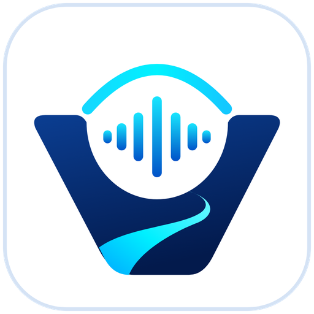

<p align="center">
  
  <br>
  
</p>

<h3 align="center">VEDAR — Твоят гласов приятел.</h3>

**VEDAR (Ведар)** е безплатен гласов асистент за Windows на български език, създаден предимно за
незрящи и слабовиждащи хора. Работи заедно с **Разказвач (Narrator)** и **NVDA**, управлява се изцяло с
глас или клавиатура и разпознава и синтезира реч **локално, без интернет**.

> Версия **0.1.0** — първа работеща версия. Вижте „Какво е проверено“ по-долу.

## Възможности

* 🎙️ **Гласово активиране** с думата „Ведар“ (локално) и **глобален клавиш** Ctrl + Shift + Интервал.
* 🗣️ **Разпознаване на българска реч на компютъра** — whisper.cpp, многоезичен модел Whisper small.
* 🔊 **Български мъжки глас** — Piper `bg_BG-dimitar-medium`, без интернет, с нормализация на числа,
  дати, часове, пари, съкращения и адреси.
* 🧭 **Местни команди без AI:** час, дата, браузър, Бележник, Документи, сайтове, четене на файлове
  (TXT, Word) и копиран текст, звук, повторение, спиране.
* 💬 **Разговор с BgGPT** (по желание, с личен ключ) със стрийминг на отговора и контекст на разговора;
  по избор **Ollama** за локален AI.
* ♿ **Достъпност:** всички контроли с имена за екранни четци, пълна клавиатурна навигация, тема с висок
  контраст и поддръжка на Windows High Contrast, без отнемане на фокуса, без двойно изговаряне.
* 🔒 **Поверителност:** без запис на звук, без телеметрия, без реклами, ключът е защитен с Windows DPAPI,
  историята е изключена по подразбиране.
* 📦 **EXE инсталатор** без администраторски права, с автоматично стартиране и деинсталиране.

## Инсталиране

1. Изтеглете `VEDAR-Setup-v0.1.0-x64.exe` (Windows 10/11, 64-bit).
2. Стартирайте го и следвайте стъпките (на български, достъпни с клавиатура).
3. При първото стартиране първоначалната настройка ще ви преведе през микрофона, гласа и (по желание)
   ключа за BgGPT.

Подробности: [INSTALLATION.md](INSTALLATION.md). Ръководство: [USER_GUIDE_BG.md](USER_GUIDE_BG.md).

## Бърз старт

| Действие | Как |
|---|---|
| Команда с глас | „Ведар, колко е часът?“ |
| Команда с клавиш | **Ctrl + Shift + Интервал**, кажете командата |
| Спри | **Ctrl + Shift + Backspace** |
| Микрофон вкл./изкл. | **Ctrl + Shift + F8** |
| Прозорецът на Ведар | **Ctrl + Alt + V** |
| Разговор | „Ведар, искам да поговорим.“ |
| Помощ | „Ведар, помощ.“ |

## Какво е проверено

| Функционалност | Как е проверена |
|---|---|
| Разпознаване на българска реч (whisper.cpp) | ✅ Автоматично с **реални модели** и **истинска човешка реч** (FLEURS, CER 17%) |
| Български мъжки глас (Piper) | ✅ Автоматично: генериране на WAV, скорост, прекъсване по средата |
| Глас → разпознаване → команда | ✅ Автоматично с реални модели (синтетичен глас): 90% точност |
| Думата „Ведар“ | ✅ 100% открити (синтетичен глас); **0 грешни активации** за 63 мин. истинска реч |
| Местни команди и потвърждения | ✅ Автоматично (~70 фрази, оркестратор с 25 сценария) |
| BgGPT (стрийминг, грешки, повторения, без интернет) | ✅ Автоматично с **mock HTTP сървър**; ⚠️ без истински ключ |
| DPAPI, регистър (autostart), WPF клавиатура и UI Automation | ✅ Автоматично на **Windows (CI)** |
| Инсталиране/стартиране/деинсталиране | ✅ Тиха инсталация на **Windows (CI)** и под Wine |
| Микрофон и звук на истински компютър | ⚠️ Не е проверено (CI няма звукови устройства) |
| Разказвач и NVDA с реален потребител | ⚠️ Не е проверено — протокол в [ACCESSIBILITY_TESTS.md](ACCESSIBILITY_TESTS.md) |

Измервания: [docs/SPEECH_BENCHMARKS.md](docs/SPEECH_BENCHMARKS.md).

## Документация

* [USER_GUIDE_BG.md](USER_GUIDE_BG.md) — ръководство на потребителя
* [INSTALLATION.md](INSTALLATION.md) — инсталиране, обновяване, деинсталиране
* [ARCHITECTURE.md](ARCHITECTURE.md) — архитектура
* [DEVELOPER_GUIDE.md](DEVELOPER_GUIDE.md) — build, тестове, разширяване
* [ACCESSIBILITY_TESTS.md](ACCESSIBILITY_TESTS.md) — тестове на достъпността
* [THIRD_PARTY_LICENSES.md](THIRD_PARTY_LICENSES.md) — лицензи
* [CHANGELOG.md](CHANGELOG.md) — промени

## Build от изходния код

```powershell
pwsh build/build.ps1
```

Резултат: `dist/VEDAR-Setup-v0.1.0-x64.exe`. Нужни са само .NET 10 SDK и PowerShell; моделите и Inno
Setup се изтеглят и проверяват автоматично. Подробности: [DEVELOPER_GUIDE.md](DEVELOPER_GUIDE.md).

## Лиценз

**GPL-3.0-or-later** (заради вградения espeak-ng). Вижте [LICENSE](LICENSE) и
[THIRD_PARTY_LICENSES.md](THIRD_PARTY_LICENSES.md). VEDAR не е свързан с OpenAI и не използва ChatGPT;
разговорите се водят с BgGPT.

---

### English summary

VEDAR is a free, Bulgarian-first voice assistant for blind and visually impaired Windows users. It works
alongside Narrator and NVDA, runs speech recognition (whisper.cpp) and the Bulgarian male voice (Piper)
fully offline, offers local Windows commands without any AI, and optional conversations through the BgGPT
API (or a local Ollama model). Built with .NET 10/WPF; installer built with Inno Setup. License: GPL-3.0-or-later.
